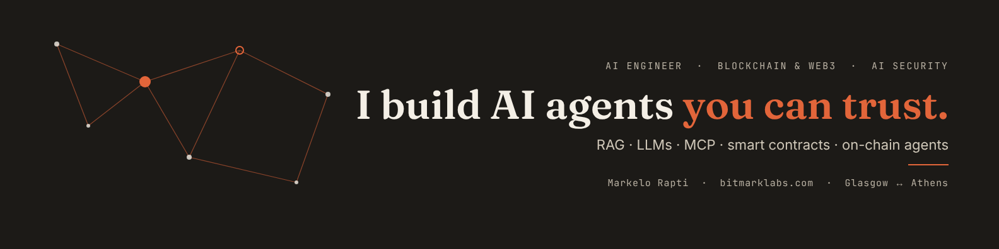

# Hi, I'm Markelo 👋

**AI Engineer** building **reliable AI agents**, with **blockchain & Web3** and **AI security** as my edge.
Digital & AI Engineer at DoTank · Founder & Lead Engineer of **BitMark Labs** · Glasgow ↔ Athens

I care about agents that work in production, not just in demos: grounded answers, evaluations that measure correctness, and systems that hold up under attack.

### What I've built

| | |
|---|---|
| **QualiNav RAG platform** (DoTank) | Retrieval-augmented AI for US rural hospitals on Vertex AI + Gemini with pgvector — cut infrastructure costs by ~96% |
| **Quantum Edge** | A 32-agent crypto trading research system with HMM market-regime detection |
| **[Veridis](https://github.com/BitMarkLabs/Veridis)** | AI agents + SUI Move smart contracts for verifiable insurance claims |
| **SoleKey** | Hardware-backed 3-factor auth (ATECC608B secure element) verified on-chain on SUI |
| **Lake Party ticketing** | QR ticketing and check-in for ~18,400 tickets with offline signature verification |

### Learning in public

- **Now:** AI agents and MCP — building agents with evaluation suites that measure correctness
- **Next:** AI security — OWASP Top 10 for LLM apps, prompt-injection labs, attacking and hardening my own agents
- **Then:** AI × crypto — Solana programs and an agent that trades on my own devnet order book

Build logs go out on [YouTube](https://www.youtube.com/@BitMarkLabs) and [X](https://x.com/BitMarkLabs).

### Stack

`Python` `TypeScript` `Solidity` `SUI Move` · `RAG` `LLMs` `MCP` `multi-agent systems` `Vertex AI` `Gemini` `Claude` `pgvector` · `React` `Next.js` `Node.js` `Flask` · `PostgreSQL` `Supabase` · `Google Cloud` `Vercel` `Docker` · `Rust` (learning)

### Get in touch

[bitmarklabs.com](https://bitmarklabs.com) · [LinkedIn](https://www.linkedin.com/in/markelorapti) · [YouTube](https://www.youtube.com/@BitMarkLabs) · [X](https://x.com/BitMarkLabs) · bitmarklabs@gmail.com

Open to AI engineering roles and freelance work on AI agents.
